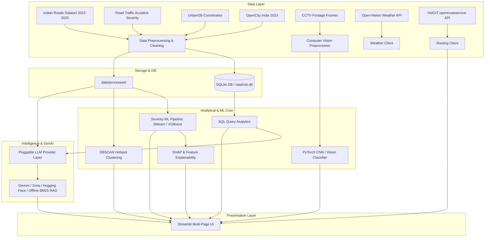

# 🚦 RoadRisk AI — AI-Powered Road Accident Analysis & Risk Intelligence Platform

[](https://www.python.org/)
[](https://streamlit.io/)
[](LICENSE)
[](tests/)

> **RoadRisk AI** is an end-to-end, multi-source road accident intelligence platform developed as an MCA Data Science portfolio project. It integrates data engineering, relational SQLite analytics, supervised machine learning (with leakage prevention), geospatial clustering, edge computer vision with Grad-CAM, historical weather correlation, explainable AI, and a grounded GenAI conversational assistant with an offline BM25 RAG engine.

---

## 🌟 Key Features

- **📊 Interactive Analytics Dashboard:** High-level KPIs, multi-dimensional breakdowns, trends by timeline, and category distributions.
- **🔍 Comprehensive Data Explorer:** In-depth schema inspection, data quality reports (null values, duplicates, outliers), search, pagination, and export tools.
- **🗄️ SQL Analytics Studio:** Structured SQLite analytical database with parameterized queries for historical trends and regional comparisons.
- **🎯 Accident Severity Classification:** Supervised ML pipeline evaluating Random Forest and Gradient Boosting models with strict target leakage prevention (eliminating post-crash casualty outcomes).
- **🗺️ Geospatial Hotspot Explorer:** DBSCAN clustering with Haversine distance metric distinguishing observed accident concentrations from true traffic risk rates, with separate UK benchmark validation on UrbanGB.
- **🌦️ Historical Weather Intelligence:** Weather feature retrieval via the Open-Meteo API with SQLite caching and atmospheric risk multipliers.
- **📹 CCTV Accident Detection & Video Sequence Audit:** MobileNetV2 transfer learning (~9.2 MB footprint, sub-50ms CPU inference) with Grad-CAM attention heatmaps, video stream frame sampling, and an empirical video sequence split leakage audit (52/58 sequence groups, 93.83% frame contamination in naive Kaggle splits, resolved to 0 leaking groups via GroupShuffleSplit).
- **🤖 Grounded AI Safety Assistant:** Dual-mode assistant with a pluggable live-LLM provider chain (Google Gemini → Groq → Hugging Face, all optional) paired with a deterministic offline BM25 documentation retriever that prevents hallucinations, blocks prompt injection, and operates on parameterized read-only queries. Provider status is shown without ever exposing a key.
- **🧭 Route & Reachability:** Live road routing, isochrones, and geocoding via the HeiGIT openrouteservice API, rendered over accident hotspots with graceful degradation when no key is configured.
- **📈 Explainable AI & Monitoring:** Model transparency powered by global Gini feature importances, single-incident risk factor decomposition, and explicit causal governance (*Feature Importance ≠ Causality*).

---

## 🏗️ System Architecture



---

## 📂 Project Directory Structure

```text
RoadRisk-AI/
├── .streamlit/
│   ├── config.toml                # Premium dark theme styling
│   └── secrets.toml.example       # API secrets template
├── app.py                         # Application main entry point & overview
├── pages/
│   ├── 1_Dashboard.py             # Module A: Interactive Analytics
│   ├── 2_Data_Explorer.py         # Module B/D: Data Quality & Explorer
│   ├── 3_SQL_Analytics.py         # Module C: SQLite Query Studio
│   ├── 4_Severity_Prediction.py   # Module E: ML Severity Classification
│   ├── 5_Hotspot_Map.py           # Module F: Geospatial Hotspot & Routing
│   ├── 6_Weather_Analysis.py      # Module G: Historical Weather Integration
│   ├── 7_CCTV_Detection.py        # Module H: CCTV Frame Accident Detection
│   ├── 8_AI_Assistant.py          # Module I: Grounded AI Road Safety Assistant
│   ├── 9_Model_Explainability.py  # Module J: SHAP & Model Explainability
│   └── 10_About.py                # Module K: Documentation & Methodology
├── src/
│   ├── __init__.py
│   ├── config.py                  # Global settings, paths & dataset metadata
│   ├── utils.py                   # UI components, dark-theme CSS & formatting
│   ├── data_loader.py             # Multi-source dataset loaders
│   ├── data_validation.py         # Quality checks & coordinate validation
│   ├── data_cleaning.py           # Preprocessing & normalization pipeline
│   ├── database.py                # SQLite schema & database lifecycle
│   ├── sql_queries.py             # Parameterized SQL query library
│   ├── features.py                # ML feature engineering & encoders
│   ├── train_severity_model.py    # Training & cross-validation scripts
│   ├── evaluate_model.py          # Confusion matrices & evaluation metrics
│   ├── explainability.py          # SHAP & tree feature importance
│   ├── hotspot_analysis.py        # DBSCAN clustering & geospatial metrics
│   ├── weather_client.py          # Open-Meteo REST API wrapper & caching
│   ├── cctv_preprocessing.py      # Image normalization & dataset loader
│   ├── cctv_inference.py          # Vision model evaluation & frame scoring
│   ├── providers.py               # Pluggable LLM provider layer (Gemini/Groq/HF/offline)
│   ├── routing_client.py          # HeiGIT openrouteservice routing & geocoding
│   ├── ai_assistant.py            # Grounded prompt logic & provider orchestration
│   └── rag_pipeline.py            # Context retrieval for project docs
├── data/
│   ├── raw/                       # Original raw datasets (gitignored)
│   ├── processed/                 # Cleaned datasets & SQLite database
│   ├── sample/                    # Lightweight sample extracts for demos
│   ├── train/                     # CCTV train image folders
│   ├── test/                      # CCTV test image folders
│   └── val/                       # CCTV validation image folders
├── models/                        # Saved joblib / PyTorch weights (gitignored)
├── notebooks/                     # Exploratory analysis Jupyter notebooks
├── tests/                         # Automated pytest test suite
├── .gitignore                     # Git ignore rules for data, models, secrets
├── requirements.txt               # Pinned package requirements
├── pytest.ini                     # Pytest configuration
├── LICENSE                        # MIT Open Source License
└── README.md                      # Comprehensive project documentation
```

---

## ⚡ Quick Start & Installation

### 1. Prerequisites
- **Python 3.12** recommended
- **Git**

### 2. Clone and Setup Environment
```bash
# Clone the repository
git clone https://github.com/<your-username>/RoadRisk-AI.git
cd RoadRisk-AI

# Create virtual environment with Python 3.12
py -3.12 -m venv .venv

# Activate virtual environment
# Windows PowerShell:
.venv\Scripts\Activate.ps1
# Windows Command Prompt:
.venv\Scripts\activate.bat
# Linux / macOS:
source .venv/bin/activate

# Upgrade pip and install dependencies
pip install --upgrade pip
pip install -r requirements.txt
```

### 3. Configure Secrets (Optional for GenAI Assistant)
Create a `.streamlit/secrets.toml` file from the provided example:
```bash
cp .streamlit/secrets.toml.example .streamlit/secrets.toml
```
Open `.streamlit/secrets.toml` (deployment) or create a local `.env` (development) and configure any optional keys. The app runs fully in offline/demo mode without them:
```toml
# Preferred provider: gemini | groq | huggingface
LLM_PROVIDER = "gemini"

# Google Gemini (current google-genai SDK)
GEMINI_API_KEY = "your-actual-gemini-key"

# Groq Cloud (optional)
# GROQ_API_KEY = "your-actual-groq-key"

# Hugging Face inference (optional)
# HF_TOKEN = "your-actual-hf-token"

# HeiGIT openrouteservice — route & reachability (optional)
# OPENROUTESERVICE_API_KEY = "your-actual-ors-key"
```
Never commit real secrets. See `.env.example` and `.streamlit/secrets.toml.example` for safe templates.

### 4. Run the Test Suite
```bash
pytest tests/ -v
```

### 5. Launch the Streamlit Application
```bash
streamlit run app.py
```
Open your browser at `http://localhost:8501`.

---

## 📜 Dataset Provenance & Attribution

| Dataset | Source | License / Terms | Usage in Platform |
|---|---|---|---|
| **Indian Road Accident Dataset (2022–2025)** | [Kaggle](https://www.kaggle.com/datasets/sehaj1104/indian-road-accident-dataset-20222025) | Public Data | National accident analytics & trend dashboards |
| **Road Traffic Accident Severity** | [Kaggle Competition](https://www.kaggle.com/competitions/road-traffic-accidents/data) | Competition Terms | Supervised accident severity ML classification |
| **UrbanGB Road Accidents Coordinates** | [UCI Machine Learning Repository](https://archive.ics.uci.edu/dataset/550) | UK Open Government Licence + ODbL | Geospatial hotspot & DBSCAN clustering (UK specific) |
| **Road Accidents in India 2023** | [OpenCity.in](https://data.opencity.in/dataset/road-accidents-in-india-2023) | Public OpenCity Data | Regional validation & comparative safety metrics |
| **CCTV Accident Footage Frames** | [Kaggle](https://www.kaggle.com/datasets/ckay16/accident-detection-from-cctv-footage) | Kaggle Dataset License | Computer vision offline accident classification |

---

## ⚠️ Responsible Use Disclaimer

1. **Educational Purpose:** RoadRisk AI is an academic portfolio project developed for educational and demonstration purposes. It is **not** an operational emergency dispatch system or certified municipal road safety enforcement tool.
2. **Correlation vs. Causation:** Weather variables, road attributes, and historical incidents reflect statistical correlations in reported records. They do not constitute deterministic proof of accident causality.
3. **Accident Concentration vs. Risk Rate:** High accident counts in a location often indicate higher vehicle density or better local reporting rather than intrinsically higher road hazard, as true traffic volume exposure metrics are absent.

---

## 📄 License

This project is licensed under the [MIT License](LICENSE).
