# RoadRisk AI — End-to-End System Architecture

```mermaid
flowchart TD
    subgraph Data_Layer ["Data Engineering & Storage Layer"]
        D1["Raw CSV/Excel Datasets<br/>(MoRTH, Kaggle, UrbanGB, OpenCity)"] --> ETL["ETL & Validation Engine<br/>(src/data_cleaning.py, src/data_validation.py)"]
        ETL --> SQLITE[("SQLite Database<br/>roadrisk.db<br/>(3 Indexed Tables)")]
        CCTV_RAW["Surveillance Video & Frames<br/>(data/train, val, test)"] --> CCTV_PREP["Sequence Audit & Grouping<br/>(src/cctv_preprocessing.py)"]
        CCTV_PREP --> MANIFEST[("cctv_grouped_manifest.csv<br/>Zero-Leakage GroupSplit")]
    end

    subgraph Analytics_Layer ["Analytical & Geospatial Intelligence"]
        SQLITE --> QUERY_BANK["Parameterized SQL Query Bank<br/>(src/sql_queries.py)"]
        SQLITE --> GEO["DBSCAN Spatial Clustering<br/>Haversine Metric (eps=1.5km)<br/>(src/hotspot_analysis.py)"]
        OM_API["Open-Meteo Weather API<br/>Historical WMO Codes<br/>(keyless default)"] --> WEATHER_CACHE[("weather_cache Table")]
        WEATHER_CACHE --> RISK_MULT["Atmospheric Risk Intelligence<br/>(src/weather_client.py)"]
        ORS_API["HeiGIT openrouteservice API<br/>Directions · Isochrones · Geocoding"] --> ROUTING["Road Routing & Reachability<br/>(src/routing_client.py)"]
    end

    subgraph Machine_Learning_Layer ["Machine Learning & Computer Vision Core"]
        SQLITE --> FEAT["Leakage-Free Feature Pipeline<br/>(src/features.py)"]
        FEAT --> SEV_MODEL["Balanced Random Forest Classifier<br/>(models/severity_pipeline.joblib)"]
        SEV_MODEL --> XAI["Model Explainability (XAI)<br/>(src/explainability.py)"]
        
        MANIFEST --> MOBILENET["MobileNetV2 Edge Classifier<br/>ImageNet-1K Transfer Learning<br/>(models/cctv_mobilenet_v2.pth)"]
        MOBILENET --> GRADCAM["Grad-CAM Saliency Engine<br/>(src/cctv_inference.py)"]
        MOBILENET --> BASELINE["Baseline Feature Classifier<br/>(Color/Thumb + LogReg)"]
    end

    subgraph GenAI_Layer ["Grounded GenAI & Knowledge Retrieval"]
        DOCS["Project Documentation & Data Cards<br/>(README.md, docs/*.md)"] --> BM25["Offline BM25 RAG Indexer<br/>(src/rag_pipeline.py)"]
        BM25 --> ASSISTANT["Grounded AI Assistant<br/>(src/ai_assistant.py)"]
        QUERY_BANK --> ASSISTANT
        SEV_MODEL --> ASSISTANT
        MOBILENET --> ASSISTANT
        PROVIDERS["Pluggable LLM Provider Layer<br/>(Gemini · Groq · Hugging Face · Offline)<br/>(src/providers.py)"] -.-> ASSISTANT
    end

    subgraph Presentation_Layer ["Streamlit Multi-Page Interactive Portal (app.py)"]
        QUERY_BANK --> P1["1_Dashboard.py (Executive KPIs)"]
        QUERY_BANK --> P2["2_Data_Explorer.py (Faceted Search)"]
        QUERY_BANK --> P3["3_SQL_Analytics.py (SQL Studio)"]
        SEV_MODEL --> P4["4_Severity_Prediction.py (Live Estimator)"]
        GEO --> P5["5_Hotspot_Map.py (Mapbox Clusters)"]
        RISK_MULT --> P6["6_Weather_Analysis.py (Meteorology)"]
        GRADCAM --> P7["7_CCTV_Detection.py (Edge Vision)"]
        ASSISTANT --> P8["8_AI_Assistant.py (Chat Interface)"]
        XAI --> P9["9_Model_Explainability.py (XAI Studio)"]
        DOCS --> P10["10_About.py (Governance & Cards)"]
    end
```

---

## Component Architecture Overview

### 1. Ingestion & Storage Architecture
- **Relational Storage**: Normalized SQLite database (`data/processed/roadrisk.db`) holding `accidents_india`, `severity_accidents`, `urbangb_accidents`, and `weather_cache`.
- **Integrity**: Full primary key constraints, B-tree indexes on `(state, city, year, accident_severity)`, and read-only query wrappers preventing data corruption.

### 2. Machine Learning & Leakage Prevention
- **Tabular Severity Classifier**: Predicts pre-crash injury severity without post-event target leakage (casualty severity and hospital treatment records are strictly excluded).
- **CCTV Edge Computer Vision**: MobileNetV2 architecture fine-tuned on binary crash classification. Solves video sequence leakage via GroupShuffleSplit grouping heuristics (`cctv_grouped_manifest.csv`).

### 3. Grounded Retrieval-Augmented Generation (RAG)
- Dual-mode architecture:
  - **Online**: A pluggable provider layer (`src/providers.py`) tries providers in preference order — **Google Gemini** (via the current `google-genai` SDK), **Groq** (OpenAI-compatible), **Hugging Face** (optional inference) — passing strictly grounded context chunks and parameterized analytical metrics. Each provider is wrapped with configurable timeouts, error isolation, and automatic fallback to the next provider.
  - **Offline**: High-speed, deterministic BM25 retriever chunking local Markdown documentation and data cards, producing accurate citation-backed responses without API keys. The offline engine is always available and is the guaranteed fallback.
- **Secret safety**: The provider layer exposes only `configured`/`available` booleans and never logs or renders key values; keys are read from environment variables locally and Streamlit secrets in deployment.
- **Retrieval relevance gate**: A BM25 score threshold is combined with a query term-coverage gate, so unsupported questions are reported as uncertain rather than answered from weak matches.

### 3b. Routing & Reachability
- **HeiGIT openrouteservice (ORS)**: `src/routing_client.py` performs directions, isochrone, and geocoding requests using `OPENROUTESERVICE_API_KEY`. Requests use the ORS `Authorization` header and `[lon, lat]` coordinate order. The "Route & Reachability" tab in `5_Hotspot_Map.py` renders live routes over accident hotspots and degrades gracefully when the key is absent.

### 4. Interactive Presentation Tier
- 10 structured Streamlit pages built using an ergonomic dark design system (`Inter` typography, glassmorphic metric cards, responsive Plotly charts, and interactive Mapbox geospatial maps).
